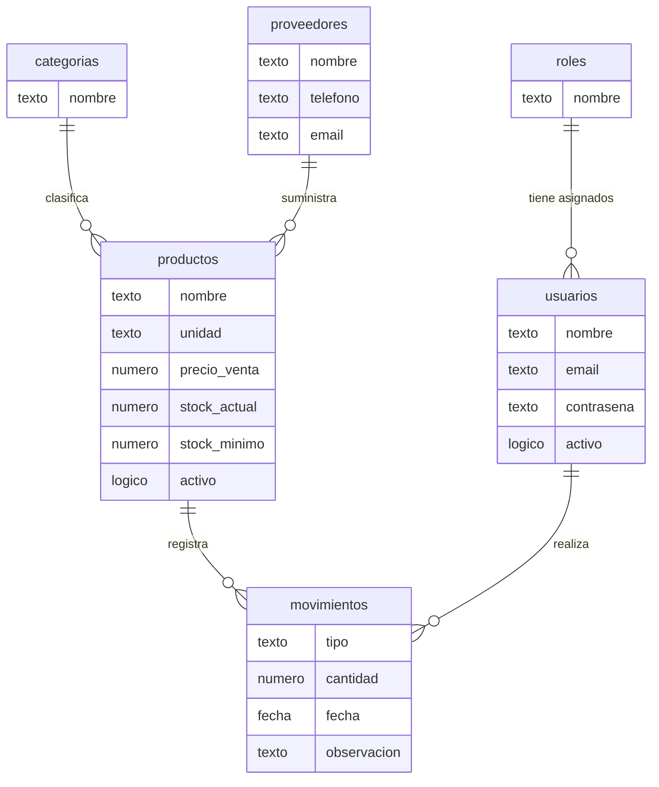
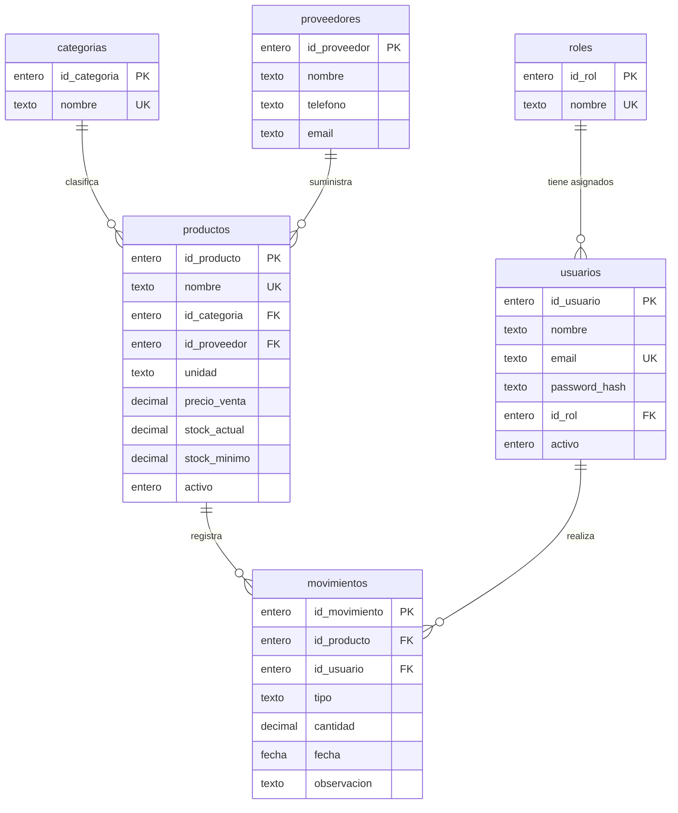
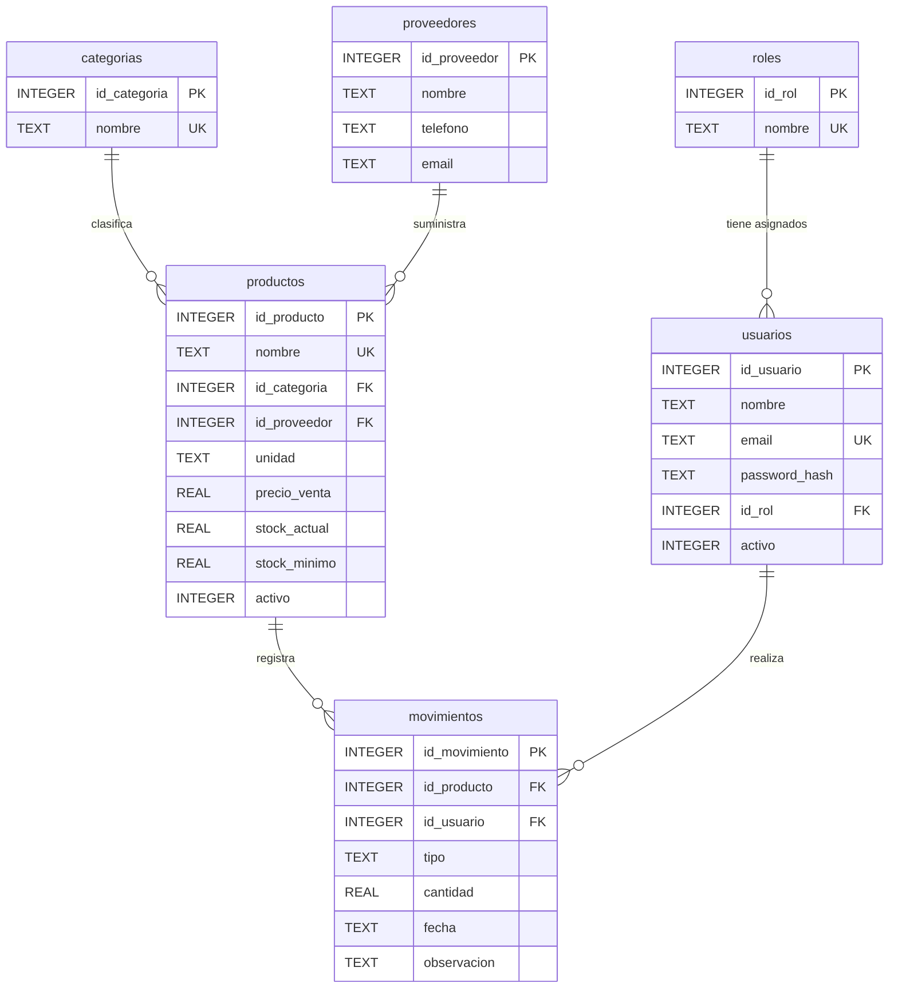

# Modelo de datos

Diseño de la base de datos del sistema de inventario de la salsamentaria. Incluye el modelo entidad-relación (conceptual), el modelo lógico, el modelo físico, el diccionario de datos y las reglas de integridad.

- **Motor:** SQLite 3 (uso autorizado por el docente en lugar de Oracle).
- **Tablas:** 6, todas relacionadas entre sí por llaves foráneas.
- **Scripts:** `sql/esquema.sql` (tablas, llaves y restricciones) y `sql/productos.sql` (datos de prueba).
- **Datos de prueba:** 2 roles, 2 usuarios, 4 categorías, 3 proveedores, 8 productos y 16 movimientos.

Los diagramas están escritos en [Mermaid](https://mermaid.js.org/), que GitHub dibuja directamente. Para exportarlos como imagen, copia el bloque en <https://mermaid.live> y descarga el PNG o el SVG.

## 1. Modelo entidad-relación (conceptual)

Describe las entidades del negocio y cómo se relacionan, sin detalles técnicos.

### Relaciones

| Entidad A | Relación | Entidad B | Cardinalidad | Lectura |
| --- | --- | --- | --- | --- |
| roles | tiene asignados | usuarios | 1 : N | Un rol puede estar asignado a muchos usuarios; cada usuario tiene un solo rol |
| categorias | clasifica | productos | 1 : N | Una categoría agrupa muchos productos; cada producto pertenece a una categoría |
| proveedores | suministra | productos | 1 : N | Un proveedor suministra muchos productos; cada producto tiene un proveedor |
| productos | registra | movimientos | 1 : N | Un producto tiene muchos movimientos; cada movimiento afecta a un producto |
| usuarios | realiza | movimientos | 1 : N | Un usuario registra muchos movimientos; cada movimiento lo registra un usuario |

La entidad **movimientos** resuelve la relación muchos a muchos entre productos y usuarios (un usuario mueve muchos productos y un producto es movido por muchos usuarios) y guarda los datos propios de cada operación: tipo, cantidad, fecha y observación.

En el lado «muchos» la participación es obligatoria (toda llave foránea es `NOT NULL`). En el lado «uno» es opcional: un rol, una categoría o un proveedor pueden existir sin registros asociados.

## 2. Modelo lógico

Traduce el modelo conceptual a tablas: agrega las llaves primarias (PK), las foráneas (FK) y las únicas (UK), con tipos genéricos independientes del motor.

### Esquemas relacionales

Notación: **llave primaria** en negrita, `columna → tabla.columna` para llaves foráneas.

1. `roles` ( **id_rol**, nombre )
2. `usuarios` ( **id_usuario**, nombre, email, password_hash, id_rol → roles.id_rol, activo )
3. `categorias` ( **id_categoria**, nombre )
4. `proveedores` ( **id_proveedor**, nombre, telefono, email )
5. `productos` ( **id_producto**, nombre, id_categoria → categorias.id_categoria, id_proveedor → proveedores.id_proveedor, unidad, precio_venta, stock_actual, stock_minimo, activo )
6. `movimientos` ( **id_movimiento**, id_producto → productos.id_producto, id_usuario → usuarios.id_usuario, tipo, cantidad, fecha, observacion )

### Normalización

- **Primera forma normal:** todas las columnas guardan valores atómicos, sin listas ni grupos repetidos.
- **Segunda forma normal:** todas las tablas tienen una llave primaria de una sola columna, así que no hay dependencias parciales.
- **Tercera forma normal:** los atributos dependen solo de la llave. El nombre de la categoría, del proveedor y del rol se guardan una sola vez en su propia tabla, y las demás tablas los referencian por su identificador.
- **Dato derivado almacenado:** `productos.stock_actual` podría calcularse sumando los movimientos. Se guarda de forma controlada para consultar rápido y para impedir salidas sin existencias. Solo cambia mediante movimientos, dentro de una transacción.

## 3. Modelo físico (SQLite)

Es la implementación concreta en SQLite, con sus tipos y restricciones. El script completo está en `sql/esquema.sql`.

### Tipos de datos y equivalencias

SQLite usa pocos tipos. Estas fueron las equivalencias con el diseño original en Oracle:

| Oracle | SQLite | Uso |
| --- | --- | --- |
| `NUMBER` con columna `IDENTITY` | `INTEGER PRIMARY KEY AUTOINCREMENT` | Identificadores |
| `VARCHAR2` | `TEXT` | Nombres, correos, tipo, unidad |
| `NUMBER(p,s)` | `REAL` | Precios, cantidades y existencias |
| `SYSDATE` | `CURRENT_TIMESTAMP` (guardado como `TEXT`) | Fecha del movimiento |
| Booleano (0 o 1) | `INTEGER` con `CHECK (activo IN (0, 1))` | Estado activo |
| `ALTER TABLE ... ADD CONSTRAINT` | Restricciones dentro del `CREATE TABLE` | Llaves foráneas y `CHECK` |

### Restricciones de integridad

| Tipo | Dónde | Qué garantiza |
| --- | --- | --- |
| Llave primaria | `id_*` de cada tabla | Cada registro es único y identificable |
| Llave foránea | `usuarios.id_rol`, `productos.id_categoria`, `productos.id_proveedor`, `movimientos.id_producto`, `movimientos.id_usuario` | No existen referencias a registros inexistentes |
| `UNIQUE` | `roles.nombre`, `usuarios.email`, `categorias.nombre`, `productos.nombre` | Sin duplicados |
| `CHECK` | `activo` (0 o 1), `unidad` (KG o UND), `precio_venta > 0`, `stock_actual >= 0`, `stock_minimo >= 0`, `tipo` (ENTRADA o SALIDA), `cantidad > 0` | Valores válidos en el motor, aunque falle el frontend |
| `NOT NULL` | Todas las columnas, salvo `proveedores.telefono`, `proveedores.email` y `movimientos.observacion` | Datos obligatorios |
| `DEFAULT` | `activo = 1`, `stock_actual = 0`, `stock_minimo = 0`, `fecha = CURRENT_TIMESTAMP` | Valores iniciales razonables |

Las llaves foráneas no declaran `ON DELETE`, así que el motor rechaza borrar un registro que otros referencian (por ejemplo, un producto con movimientos o un rol asignado a usuarios). La API traduce ese rechazo en un `409 Conflict`. SQLite solo valida las llaves foráneas cuando se activa `PRAGMA foreign_keys = ON`, y la aplicación lo hace en sus conexiones.

## 4. Diccionario de datos

### `roles`

Perfiles de acceso al sistema.

| Columna | Tipo | Nulo | Restricciones | Descripción |
| --- | --- | --- | --- | --- |
| `id_rol` | INTEGER | No | PK, autoincremental | Identificador del rol |
| `nombre` | TEXT | No | UNIQUE | Nombre del rol (ADMINISTRADOR, VENDEDOR) |

### `usuarios`

Cuentas que pueden iniciar sesión.

| Columna | Tipo | Nulo | Restricciones | Descripción |
| --- | --- | --- | --- | --- |
| `id_usuario` | INTEGER | No | PK, autoincremental | Identificador del usuario |
| `nombre` | TEXT | No | — | Nombre completo |
| `email` | TEXT | No | UNIQUE | Correo, se usa para iniciar sesión |
| `password_hash` | TEXT | No | — | Hash PBKDF2-SHA256 de la contraseña (nunca se guarda en texto plano) |
| `id_rol` | INTEGER | No | FK → roles(id_rol) | Rol asignado |
| `activo` | INTEGER | No | CHECK activo IN (0, 1); DEFAULT 1 | 1 = puede iniciar sesión, 0 = desactivado |

### `categorias`

Clasificación de los productos.

| Columna | Tipo | Nulo | Restricciones | Descripción |
| --- | --- | --- | --- | --- |
| `id_categoria` | INTEGER | No | PK, autoincremental | Identificador de la categoría |
| `nombre` | TEXT | No | UNIQUE | Nombre de la categoría |

### `proveedores`

Quienes suministran los productos.

| Columna | Tipo | Nulo | Restricciones | Descripción |
| --- | --- | --- | --- | --- |
| `id_proveedor` | INTEGER | No | PK, autoincremental | Identificador del proveedor |
| `nombre` | TEXT | No | — | Nombre del proveedor |
| `telefono` | TEXT | Sí | — | Teléfono de contacto (opcional) |
| `email` | TEXT | Sí | — | Correo de contacto (opcional) |

### `productos`

Catálogo de productos del inventario.

| Columna | Tipo | Nulo | Restricciones | Descripción |
| --- | --- | --- | --- | --- |
| `id_producto` | INTEGER | No | PK, autoincremental | Identificador del producto |
| `nombre` | TEXT | No | UNIQUE | Nombre del producto |
| `id_categoria` | INTEGER | No | FK → categorias(id_categoria) | Categoría a la que pertenece |
| `id_proveedor` | INTEGER | No | FK → proveedores(id_proveedor) | Proveedor que lo suministra |
| `unidad` | TEXT | No | CHECK unidad IN ('KG', 'UND') | Unidad de medida: KG o UND |
| `precio_venta` | REAL | No | CHECK precio_venta > 0 | Precio de venta, mayor que cero |
| `stock_actual` | REAL | No | CHECK stock_actual >= 0; DEFAULT 0 | Existencias actuales; solo cambian con movimientos |
| `stock_minimo` | REAL | No | CHECK stock_minimo >= 0; DEFAULT 0 | Existencias mínimas antes de alertar stock bajo |
| `activo` | INTEGER | No | CHECK activo IN (0, 1); DEFAULT 1 | 1 = disponible para operar, 0 = inactivo |

### `movimientos`

Historial de entradas y salidas de inventario.

| Columna | Tipo | Nulo | Restricciones | Descripción |
| --- | --- | --- | --- | --- |
| `id_movimiento` | INTEGER | No | PK, autoincremental | Identificador del movimiento |
| `id_producto` | INTEGER | No | FK → productos(id_producto) | Producto afectado |
| `id_usuario` | INTEGER | No | FK → usuarios(id_usuario) | Usuario que registró el movimiento |
| `tipo` | TEXT | No | CHECK tipo IN ('ENTRADA', 'SALIDA') | ENTRADA (ingreso) o SALIDA (venta o retiro) |
| `cantidad` | REAL | No | CHECK cantidad > 0 | Cantidad movida, mayor que cero |
| `fecha` | TEXT | No | DEFAULT CURRENT_TIMESTAMP | Fecha y hora del registro (texto ISO, por defecto la actual) |
| `observacion` | TEXT | Sí | — | Nota opcional |

## 5. Reglas de negocio que apoyan el modelo

Algunas reglas las aplica la base de datos (restricciones) y otras la aplicación:

| Regla | La aplica |
| --- | --- |
| El precio es mayor que cero, y el stock y los mínimos no son negativos | Base de datos (`CHECK`) |
| La unidad es `KG` o `UND`, y el tipo de movimiento es `ENTRADA` o `SALIDA` | Base de datos (`CHECK`) |
| No hay correos, nombres de rol, categoría ni producto repetidos | Base de datos (`UNIQUE`) |
| No se elimina una categoría o proveedor con productos, un producto con movimientos ni un rol asignado | Base de datos (llave foránea) y API (`409`) |
| Una salida solo se registra si hay stock suficiente | Aplicación (transacción) |
| El stock solo cambia mediante movimientos, y al corregir uno se ajusta por la diferencia | Aplicación (transacción) |
| Las cantidades de productos en `UND` son enteras | Aplicación |
| Un usuario con `activo = 0` no puede iniciar sesión | Aplicación |
| La contraseña se guarda solo como hash | Aplicación |

## 6. Cómo reproducir la base

La aplicación crea las tablas al arrancar, ejecutando `sql/esquema.sql`. Los datos de prueba se cargan una sola vez con `sql/productos.sql` (o con `CARGAR_DATOS_EJEMPLO=1`). Ver el `README.md` para los comandos.
